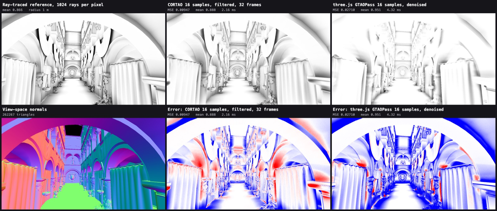

# cortao.js

[CORTAO](https://github.com/theagentd/CORTAO) (Circular Occluder Ray-Traced Ambient Occlusion, by Daniel Isheden) for three.js: screen-space ambient occlusion that treats each depth sample as a circular occluder and tests it against 32 rays through a precomputed lookup table, instead of tracking horizons.

```bash
pnpm add github:nilo-technologies/cortao.js#v0.1.0
```

| Import | Renderer |
|--------|----------|
| `cortao.js` | `WebGPURenderer` (TSL node, WebGPU and WebGL2 backends) |
| `cortao.js/webgl` | `WebGLRenderer` (WebGL2 render pass) |
| `cortao.js/lookup-table` | The occluder lookup table generator alone |

Peer dependency: `three` r187 or later.

## WebGPURenderer

```js
import * as THREE from 'three/webgpu';
import { pass, vec4 } from 'three/tsl';
import { CortaoNode } from 'cortao.js';

const scenePass = pass(scene, camera);
const cortao = new CortaoNode(scenePass.getTextureNode('depth'), () => camera);
cortao.radius.value = 1; // world units
cortao.sampleCount = 16; // 4, 8, 16 or 32; a change rebuilds one shader
cortao.resolutionScale = 0.5; // of the depth texture's size; 0.5 draws a quarter of the pixels
cortao.temporalBlend.value = 0.1; // share of each new frame in the history; 1 keeps none

const pipeline = new THREE.RenderPipeline(renderer);
pipeline.outputNode = vec4(scenePass.getTextureNode().rgb.mul(cortao.getTextureNode().r), 1);
```

`cortao.enabled = false` skips all its passes. Samples and radius can change at run time, so quality can follow a frame-time budget.

## WebGLRenderer

```js
import { CortaoPass } from 'cortao.js/webgl';

const cortao = new CortaoPass(width, height);
cortao.params.maxRadius = 1;
cortao.params.sampleCount = 16;
// Each frame, after drawing linear depth and view-space normals into a G-buffer:
const occlusion = cortao.render(renderer, camera, depthTexture, normalTexture, { filter: true });
```

## Quality and cost

1280×720, Apple M1 Pro, WebGL2. Error is mean squared difference from a ray-traced reference (1024 rays per pixel, three-mesh-bvh); lower is better. Times are milliseconds per frame, measured on the wall clock with the GPU drained before and after, so they include driver overhead.

| Sponza | Error | ms |
|--------|------:|---:|
| CORTAO 4 samples, filtered | 0.0232 | 1.08 |
| CORTAO 8 samples, filtered | 0.0171 | 1.34 |
| CORTAO 16 samples, filtered | 0.0132 | 2.16 |
| CORTAO 32 samples, filtered | 0.0110 | 3.71 |
| three.js GTAOPass 16 samples, denoised | 0.0271 | 4.32 |
| three.js GTAOPass 32 samples, denoised | 0.0249 | 7.94 |



The comparison page now times passes with `EXT_disjoint_timer_query_webgl2` when the browser exposes it, and labels each time `gpu` or `wall`. The WebGPU example reads GPU milliseconds per frame from timestamp queries.

## Differences from the reference

- Normals are rebuilt from depth in the WebGPU node; the WebGL pass takes a normal texture.
- The packed depth and normal buffer has no mip chain.
- The WebGPU node accumulates frames itself: it reprojects last frame's occlusion by depth and drops it where the depth does not match, so its noise, which changes each frame, averages out while the camera moves. The reference leaves this to the host's TAA. Objects that move while the camera stays still keep a short trail of their old occlusion. The WebGL pass has no temporal filter.
- The WebGPU node draws at half the depth texture's size by default (`resolutionScale`). At 2880×1800 on an Apple M1 Pro, 16 samples cost about 20 ms per frame at full size and about 5 to 9 ms at half, on the wall clock.
- The lookup table is generated at start-up (a few milliseconds) instead of loaded from a file; `pnpm test` checks it equals the reference's table bit for bit.

## Examples

```bash
pnpm install
pnpm fetch-sponza   # optional: Sponza geometry from Khronos glTF-Sample-Assets
pnpm dev            # http://127.0.0.1:4791/ comparison, /webgpu.html live demo
```

- `examples/index.html` renders CORTAO, GTAOPass and the ray-traced reference from one G-buffer; **Capture comparison set** writes PNGs and metrics to `examples/out/`. The reference is heavy: expect the GPU to be busy for a minute or more.
- `examples/webgpu.html` orbits the scene with `CortaoNode`, buttons for sample counts, and a GPU ms readout.
- `pnpm --filter @cortao/examples capture` and `video` drive the comparison headless with Playwright.

## License

MIT, see [LICENSE](LICENSE). The CORTAO reference is MIT, Copyright (c) 2026 Daniel Isheden, see [LICENSE-cortao](LICENSE-cortao). Sponza is not redistributed.
